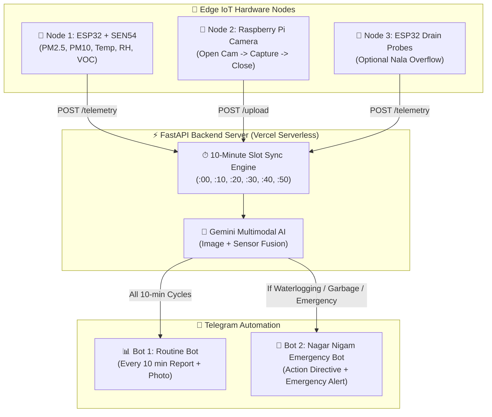

# 🏙️ Smart City AI: Multimodal Urban Operations System
### ESP32 (SEN54) + Raspberry Pi (Camera) + Gemini AI + Dual Telegram Bots + FastAPI on Vercel

---

## 📌 Project Overview (हिंदी विवरण)
यह एक **Autonomous Smart City Urban Operations System** है, जिसमें **Node 1 (ESP32)**, **Node 2 (Raspberry Pi Camera)**, और एक **FastAPI Backend (Vercel Serverless Hosted)** शामिल हैं:

1. **Node 1 (ESP32 + Sensirion SEN54)**:
   - वायु गुणवत्ता (Air Quality) और मौसम (PM1.0, PM2.5, PM10, Temperature, Humidity, VOC Index) का रियल-टाइम डेटा एकत्र करता है।
2. **Node 2 (Raspberry Pi + Camera)**:
   - सड़क/नालों के पास लगा होता है।
   - **पावर-सेविंग मोड**: हर 10 मिनट में सिर्फ 1-2 सेकंड के लिए कैमरा खोलता है, सड़क की फ़ोटो लेता है, और कैमरा तुरंत बंद कर देता है।
3. **10-Minute Synchronization**:
   - दोनों नोड्स (ESP32 & Raspberry Pi) NTP घड़ी से सिंक होकर ठीक हर 10 मिनट के चक्र (`:00`, `:10`, `:20`, `:30`, `:40`, `:50`) पर डेटा बैकएंड को भेजते हैं। बैकएंड दोनों डेटा को एक साथ जोड़कर प्रोसेस करता है।
4. **Google Gemini Multimodal AI**:
   - दोनों नोड्स के डेटा (सेंसर रीडिंग्स + सड़क की तस्वीर) को एक साथ एनालाइज़ करता है:
     - 💧 **सड़क जल भराव (Waterlogging / Puddles / Flooding)**
     - 🗑️ **कूड़ा जमा होना (Garbage Dumping / Waste heaps)**
     - 💨 **वायु प्रदूषण और मौसम स्थिति**
5. **Dual Telegram Bot System (2 बॉट आर्किटेक्चर)**:
   - 🤖 **Bot 1 (`@people_sefty_system_bot`)**: हर 10 मिनट में रूटीन प्रेडिक्शन रिपोर्ट + सड़क की तस्वीर भेजता है।
   - 🚨 **Bot 2 (`@smart_citypatna04_bot`)**: केवल आपातकालीन स्थिति में (जब सड़क पर पानी भरा हो, कूड़ा जमा हो, या एक्शन की आवश्यकता हो) नगर निगम को अलर्ट और जीपीएस लोकेशन भेजता है।

---

## 🏛️ System Architecture



---

## 📂 Project Structure

```
SMART_CITY_SYSTEM/
│
├── backend/                       # FastAPI Vercel Serverless Backend
│   ├── api/
│   │   └── index.py               # Core FastAPI app (Gemini, Telegram, Dashboard)
│   ├── main.py                    # Local development runner
│   ├── vercel.json                # Vercel deployment configuration
│   ├── requirements.txt           # Python dependencies
│   ├── .env                       # Pre-configured API keys & tokens
│   └── .env.example
│
├── node_1_esp32_sen54/            # Node 1: ESP32 + Sensirion SEN54
│   ├── node_1_esp32_sen54.ino     # Arduino source code (NTP 10-min sync)
│   └── README.md                  # Circuit, Pinout & Library guide
│
├── node_2_raspberry_pi_camera/    # Node 2: Raspberry Pi Street Camera
│   ├── camera_node.py             # Open -> Capture -> Close power-saving script
│   ├── citymind_camera.service    # Auto-start systemd service on boot
│   ├── install_service.sh         # 1-click Linux installer
│   ├── requirements.txt
│   └── README.md
│
├── node_3_esp32_drain_mq135/      # Node 3: Optional Drain & Sewer Gas station
│   ├── node_3_drain_mq135.ino
│   └── README.md
│
└── README.md                      # Complete documentation
```

---

## 🚀 Vercel Backend Deployment Guide

### Option 1: Deploy with Vercel CLI (Recommended)
1. Vercel CLI इनस्टॉल करें (अगर नहीं है):
   ```bash
   npm install -g vercel
   ```
2. `backend` डायरेक्टरी में जाएँ:
   ```bash
   cd "SMART_CITY_SYSTEM/backend"
   ```
3. Vercel पर डिप्लॉय करें:
   ```bash
   vercel --prod
   ```
4. डिप्लॉय होने के बाद आपको एक URL मिलेगा (जैसे: `https://your-smart-city.vercel.app`).
5. इस URL को ESP32 कोड (`BACKEND_URL`) और Raspberry Pi कोड (`BACKEND_URL`) में अपडेट करें।

### Option 2: Deploy via GitHub
1. इस फोल्डर को अपने GitHub रिपॉजिटरी में पुश करें।
2. [Vercel Dashboard](https://vercel.com/) पर जाएं और **Add New Project** चुनें।
3. Root Directory को `SMART_CITY_SYSTEM/backend` सेट करें।
4. **Deploy** पर क्लिक करें।

---

## 💻 Local Testing (अपने कंप्यूटर पर टेस्ट कैसे करें)

1. आवश्यक लाइब्रेरी इंस्टॉल करें:
   ```bash
   cd "SMART_CITY_SYSTEM/backend"
   pip install -r requirements.txt
   ```
2. सर्वर स्टार्ट करें:
   ```bash
   python main.py
   ```
3. ब्राउज़र में लाइव डैशबोर्ड खोलें:
   👉 **http://localhost:8000/dashboard**

---

## 📡 Hardware Setup & Node Deployment

### 1. Node 1: ESP32 + SEN54
- ESP32 को कंप्यूटर से कनेक्ट करें।
- Arduino IDE में `node_1_esp32_sen54/node_1_esp32_sen54.ino` खोलें।
- अपना WiFi SSID और Password डालें:
  ```cpp
  const char* WIFI_SSID     = "YOUR_WIFI";
  const char* WIFI_PASSWORD = "YOUR_PASSWORD";
  const char* BACKEND_URL   = "https://your-project.vercel.app/telemetry";
  ```
- **Sensirion I2C SEN5x** और **ArduinoJson** लाइब्रेरी इंस्टॉल करके फ़्लैश करें।

### 2. Node 2: Raspberry Pi Camera
- Raspberry Pi पर `SMART_CITY_SYSTEM/node_2_raspberry_pi_camera` फोल्डर कॉपी करें।
- 1-क्लिक इंस्टॉलर चलाएं:
  ```bash
  chmod +x install_service.sh
  ./install_service.sh
  ```
- यह सर्विस बूट होते ही ऑटोमैटिक बैकग्राउंड में चालू हो जाएगी।
- कैमरा सिर्फ 10-10 मिनट पर 1 बार खुलेगा, फोटो लेगा, और तुरंत हार्डवेयर रिलीज कर देगा।

---

## 🤖 Dual Telegram Bot Details

| Bot Role | Telegram Handle / ID | Token | Trigger Condition |
|:---|:---|:---|:---|
| **Bot 1: Routine Analysis** | `@people_sefty_system_bot` | `8830694274:AAFPQ...` | हर 10 मिनट के चक्र पर (नियमित अपडेट + फोटो) |
| **Bot 2: Nagar Nigam Emergency** | `@smart_citypatna04_bot` | `8883635861:AAErN...` | केवल जल भराव / कूड़ा जमाव / आपातकालीन स्थिति पर |
